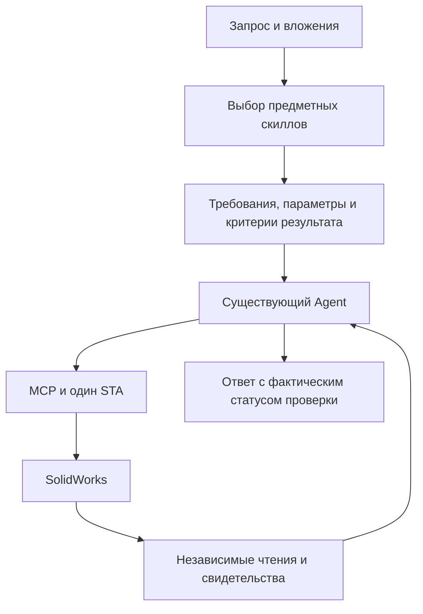

# SolidWorks Automation Skill: исследование и применение в CAD-Agent-Next

Дата: 26 октября 2026 года. Изучен [wzyn20051216/solidworks-automation-skill][repository]
на коммите `f9d6efbecf297bcdfffc451de81ba3a7bdea6a0d`.
В исходной ссылке пользователя отсутствовала последняя `l` в `skill`; адрес с `skil` возвращает 404.

Это исследовательская записка с предложениями. Анализ относится к исходникам указанного
коммита и текущему рабочему дереву CAD-Agent-Next, включая незавершённые изменения.
Прочитаны корневой `SKILL.md`, все пять подскиллов, их манифесты, связанные схемы,
ключевые участки планировщика, предметных исполнителей, проверки результатов и тестов.
Внешний проект клонирован во временный каталог. Его установщик, скрипты, тесты и CAD-вызовы
в рамках исследования не запускались; заявленные автором live-результаты здесь не воспроизводились.

## Основной вывод

Стоит перенять организацию инженерных знаний в скиллы и их связь с проверяемыми
требованиями к результату. Для нашего приложения это отдельный слой между пониманием
задачи и существующим исполнением через MCP. Он может уменьшить число догадок модели
о SolidWorks API, стабилизировать порядок построения и сделать успешные решения повторно
используемыми. Улучшение качества и расхода токенов пока является гипотезой для измерения.

Наибольшая ближайшая польза — скиллы Python/COM-инспекции, листового моделирования,
восстановления требований по чертежу и проверки результата. Скиллы резьбы, скруглений
и инженерных чертежей полезны как следующий предметный слой, которому потребуются
собственные исполнители и независимые чтения на нашей версии SolidWorks.

## 1. Как устроены их скиллы

У проекта три входа: скилл для внешнего агента, MCP и настольный CAD Studio.
Используются общие предметные скрипты и реестр возможностей. Корневой скилл объясняет
агенту маршруты работы; подскиллы уточняют отдельные инженерные процедуры.
[Корневые инструкции][root-skill], [каталог подскиллов][subskills-index],
[описание Execution Core][execution-core].

| Слой | Содержимое | Что даёт |
|---|---|---|
| Корневой `SKILL.md` | Условия применения, подключение, единицы, маршруты, правила API и проверки | Агент понимает, к какой процедуре обратиться |
| `subskills/<name>/SKILL.md` | Предметный порядок действий и границы применимости | Знания подключаются для конкретного класса задач |
| `manifest.yaml` | Статус пакета, скрипты, зависимости, справочники, примеры | Машиночитаемый индекс ресурсов |
| `references/`, `knowledge/`, `schemas/` | Проверенные приёмы, таблицы, ограничения, структуры входа | Меньше повторного изобретения и угадывания |
| `scripts/` | Проверки параметров, геометрические операции, сбор свидетельств | Реальное выполнение и часть инженерных ограничений |
| `capabilities.yaml` | Уровни отдельных возможностей, версии, ограничения, маршруты бэкендов | Уточнение, что действительно доступно в данном окружении |
| `evals/`, `tests/`, `golden-workflows.yaml` | Запросы с ожидаемым поведением, контрактные тесты, сценарии | Возможность проверять развитие библиотеки |

Здесь полезно различать три сущности: скилл сообщает, **как решать задачу**; инструмент
выполняет **действие**; независимая проверка устанавливает, **что получилось**.
Markdown сам по себе не создаёт инструмент и не подтверждает геометрию.

Внешний агент читает корневой скилл и по его указаниям открывает нужный подскилл.
В просмотренном MCP-входе нет автоматического превращения этих Markdown-файлов
в знания произвольного клиента. `manifest.yaml` тоже не является исполнителем.
[MCP-вход][mcp-server], [установщик][installer].

Это особенно существенно для CAD-Agent-Next: установка пакета в пользовательский каталог
скиллов поможет работающему над проектом coding agent, но сама по себе не изменит
поведение модели внутри нашего чата. Нашему приложению нужен собственный загрузчик знаний.

## 2. Подробный разбор пяти подскиллов

Статусы в таблице взяты из манифестов/индекса пакетов автора. Их нельзя переносить на
нашу реализацию: уровень конкретной операции дополнительно ограничен реестром возможностей,
версией SolidWorks и подтверждённым сценарием.

| Подскилл | Статус пакета | Сильная сторона | Применение у нас |
|---|---|---|---|
| `solidworks-vibecad` | experimental | Параметрический план, допущения, риски и план проверки | Формализация требований перед построением |
| `solidworks-fillet-chamfer-cnc` | stable | Проверка параметров до COM, выбор рёбер по геометрии, чтение созданных элементов | Основа будущих скруглений/фасок и предметных проверок |
| `solidworks-threaded-holes` | stable | Разделение параметров резьбы и отверстия, точная семантика, проверка подэлементов | Предметная спецификация отверстия и критерии приёмки |
| `solidworks-engineering-drawing` | pilot | `DrawingSpec`, полнота размеров, проверка итогового PDF | Отдельный этап развития инженерных чертежей |
| `autocad-automation` | stable | План 2D-документа, слои, координаты, фактическая проверка файлов | Отдельные принципы проверки DXF; новый CAD-бэкенд пока избыточен |

### 2.1. VibeCAD: требования → структурированный план

Скилл предлагает цепочку «предметные знания → параметры → план → исполнитель → проверка».
В схеме есть `part_family`, `parameters`, `features`, `operation_sequence`,
`assumptions`, `risk_register`, `review_plan`, а также соответствия операций API.
Наличие плана проверки — хорошее требование: построение заранее связано с критериями
результата. [Скилл][vibecad-skill], [схема][vibecad-schema].

Важное ограничение реализации: `plan_from_brief.py` использует регулярные выражения
и формирует конкретный `cnc_mount`. Если данные не найдены, применяет, например,
90×60×8 мм и M5; материал в выходном плане задан как алюминий 6061. CLI не загружает
схему для валидации результата и не читает `manufacturing_rules.yaml`: часть таблиц
дублируется в Python. `sw_execution_outline.py` формирует описание шагов без COM.
Это полезный прототип шаблона, но не универсальный исполнитель произвольного замысла.
[Планировщик][vibecad-planner], [генератор описания][vibecad-outline].

При этом в проекте отдельно существуют `scripts/design_spec.py`,
`scripts/build_from_spec.py` и MCP-инструменты `design_spec_validate/design_spec_build`.
Они используют другой формат спецификации, поддерживающий ограниченный набор базовых тел,
отверстий и скруглений. Поэтому вывод «структурированного исполнения нет» был бы неверным;
автоматическая связь именно VibeCAD-плана с этим исполнителем в просмотренной цепочке
не показана. [Исполнитель спецификации][spec-builder].

Для нас стоит взять единый план с явными единицами, координатной системой, требованиями
и проверками, а затем отображать его на уже доступные инструменты. Критические отсутствующие
размеры нельзя заменять произвольными значениями. Для каждой семьи деталей нужны
ограниченные типизированные поля и проверки связей между ними: общий свободный словарь
`parameters` этого не обеспечивает. Не следует начинать с универсального языка CAD.

### 2.2. CNC: скругления и фаски

Самое ценное здесь — работа до изменяющего COM-вызова. Отдельный `cnc_strategy.py`
проверяет конечность чисел, границы радиусов, пересечения отверстий/пазов/карманов,
расстояния до края и остаточную толщину. План можно получить через `--dry-run`.
Выбор рёбер основан на геометрических признаках; шаблон требует точного числа кандидатов.
Если число не совпало, операция останавливается. [Скилл][cnc-skill],
[проверки параметров][cnc-strategy], [выбор рёбер][cnc-executor].

Полезен и описанный порядок для конкретного CNC-шаблона: базовое тело → внешние
скругления/фаски → отверстия/карманы → фаски у отверстий. Его стоит хранить вместе
с областью применимости: для изменения существующего дерева порядок определяется
зависимостями, а не универсальным правилом «скругления всегда сначала».

Продвинутые скругления привязаны к узким live-сценариям SW2026 SP1.1. Например,
наличие интерфейса для hold-line не считается поддержкой операции; известный сбой
оставляет её заблокированной. Проверка реального параметра после перестроения
и повторного открытия полезнее простого наличия API в библиотеке типов.

Переносить `apply_treatment` целиком нельзя: режим `progressive` допускает попытки
100%/75%/50% размера после возврата `None`. Наши инварианты не допускают такого
повторения мутаций. Возврат `None` не доказывает отсутствие частичных изменений;
уменьшенный радиус также меняет требования. Нужно сохранить предварительную проверку,
точный выбор и чтение результата, исключив эту лестницу повторов.
[Реализация попыток][cnc-attempts].

### 2.3. Резьбовые отверстия

Хорошо разделены номинальный диаметр, шаг, диаметр сверления, глубина отверстия,
длина резьбы, заходная фаска, направление и класс допуска. Стабильный шаблон относится
к новому прямоугольному образцу с ограниченным набором ISO метрической внутренней резьбы
M3–M12. Изменение существующей детали, внешняя/трубная резьба и Hole Wizard имеют
другую зрелость. [Скилл][thread-skill].

Предметные знания, которые стоит адаптировать:

- Сквозное отверстие должно иметь условие `Through All`, а не просто увеличенную глубину.
- Условия окончания выреза, Thread и CosmeticThread используют разные перечисления.
- Глубина резьбы, глубина сверления и толщина связаны ограничениями ещё до COM.
- Для нестандартного шага диаметр сверления нельзя считать подтверждённым по одной формуле.
- CosmeticThread может быть подэлементом: проверка только верхнего уровня дерева неполна.
- Настоящая геометрия, условное обозначение и вспомогательная спираль должны различаться
  в требованиях и свидетельствах результата. [Практические заметки][thread-lessons].

В шаблоне есть автоматический переход Thread → CosmeticThread → видимая спираль.
Для нас это несовместимо с правилами выполнения; требование настоящей геометрии нельзя
считать выполненным условным изображением. Вид представления следует определить до
построения. После ошибки применяются наши stop/uncertain и ограниченное исправление
известного Python `CAD_ERROR`, а не следующий способ создания резьбы.
[Фактическая цепочка][thread-executor].

Скилл можно использовать как основу будущего `ThreadedHoleSpec`, но сам перенос текста
не добавит нам специализированного инструмента и независимой проверки резьбы.

### 2.4. Инженерные чертежи

Это наиболее интересный задел для самостоятельной будущей функции. `DrawingSpec`
задаёт стандарт, проекцию, лист, масштаб, виды, необходимые размеры, отверстия, BOM,
штамп и форматы. Неподдержанное поле должно блокировать операцию до изменения документа,
а не исчезать при исполнении. Это поведение закреплено контрактными тестами.
[Скилл][drawing-skill], [схема][drawing-schema], [тесты][drawing-tests].

Сильное решение — проверять фактический итоговый PDF: связывать прочитанные размеры
SolidWorks с текстовыми рамками в PDF, искать наложения, контролировать наличие видов,
размеров, отверстий и таблиц. Созданный непустой PDF ещё не доказывает полноту чертежа.
Обычная текстовая заметка также не заменяет настоящий объект размера, базы или допуска.
[Рецензент чертежа][drawing-reviewer].

Скилл ориентирован на GB/T и первую проекцию. У нас стандарт следует определять по
задаче и шаблону пользователя: ЕСКД/ГОСТ, ISO или иной согласованный формат; язык чата
не определяет стандарт автоматически. Геометрические допуски и технологическую
достаточность нельзя объявлять полностью проверенными только по наличию обозначений.

В текущем каталоге наших 27 MCP-инструментов нет специализированного генератора
SLDDRW/PDF. Это расширение продукта с новым исполнением и проверками, а не подключение
одного Markdown-файла. Для листовых деталей первым условием остаётся достоверная развёртка.

### 2.5. AutoCAD

Полезны отдельный план документа, единицы, система координат, слои, реальные размерные
объекты и проверка результатов по объектам/файлам/предпросмотру. Работа с исходным DWG
и пакетная обработка явно выделены в отдельные процедуры. [Скилл][autocad-skill].

Но `stable` у пакета не означает стабильность каждого бэкенда. Например,
`autocad_basic_drafting` в реестре имеет `not_implemented`, а `.NET`-маршрут — `pilot`;
текст скилла описывает более сильный статус для части runtime-свидетельств.
Это пример того, почему общий ярлык не должен заменять точную матрицу возможностей.
[Матрица автора][capabilities].

CAD-Agent-Next сейчас работает с SolidWorks. Экспорт его развёртки в DXF не требует
AutoCAD. Разумно перенять критерии проверки DXF; добавление AutoCAD, .NET и управления
вторым CAD-процессом оставить отдельной задачей, если появится такая потребность.

## 3. Что уже есть в CAD-Agent-Next и чего не хватает

| Область | Текущее основание | Что добавят скиллы |
|---|---|---|
| Общие инструкции | `_SYSTEM_RU/_SYSTEM_EN`, обновляемые в `Agent._model` | Предметные инструкции по текущей задаче |
| Возможности | Каталог MCP с JSON Schema, проверка аргументов | Связь инженерной задачи с инструментами и подтверждённым сценарием |
| Выполнение | Один Run, последовательные вызовы, один STA, блокировка после неизвестного исхода | Эти правила остаются обязанностью исполнения |
| Проверка | `_verification_calls`, `_verify`, `Run.verification` | Более точные требования к результату и будущие предметные чтения |
| Python | `execute_python`, `GET`, показ кода и постоянное разрешение приложения | Проверенные рецепты, ограничения API, минимальные продолжения после известных ошибок |
| Изображения | Вложения, Vision, отдельная предварительная обработка изображений | Правила извлечения размеров и переноса их в геометрические требования |
| Контекст | Полная локальная история, отдельная проекция для модели, `PrivacyContext` | Выбор небольшого объёма нужных справочных знаний |

Основания: [агент](../../cadnext/agent.py), [MCP-клиент](../../cadnext/mcp.py),
[провайдер](../../cadnext/provider.py), [проекция контекста](../../cadnext/context.py),
[подготовка изображений](../../cadnext/preparation.py),
[описание проверок](../agent.md), [Python/COM-инспекция](../python-inspection.md).

Наше правило «успешный вызов не доказывает геометрию» уже реализовано. Поэтому главный
выигрыш внешнего проекта для нас — предметное содержание и организация знаний.
Замена нашего агентского цикла их Execution Core не требуется для получения этой пользы.

Отдельно полезна идея проверки **редактируемости**: статус ограничений эскиза,
управляющие размеры/связи, отсутствие подмены проектирования массовым Fix, использование
эскиза ожидаемым элементом. У автора есть `sw_sketch_quality.py`. У нас наличие элемента
в дереве пока не доказывает эти свойства; для такого критерия потребуется специальное
чтение, а до него результат должен оставаться `unverified` по соответствующей части.
[Проверка эскизов автора][sketch-quality].

## 4. Предлагаемое включение скиллов в приложение

### Выбор масштаба

| Подход | Польза и цена | Оценка |
|---|---|---|
| Собрать все знания в общий prompt | Простой старт, но растёт каждый запрос и смешиваются предметные инструкции | Подходит только для очень малого объёма |
| Встроенный каталог и загрузка нужных процедур | Ограниченный контекст, версионирование, совместимость с нашим провайдером | Рекомендуемое начало |
| Формальная CAD-спецификация с предметным исполнителем | Сильнее проверяемость и повторяемость, но нужны новый формат, исполнение и критерии | Следующий этап после проверки пользы библиотеки |

Предлагаемый поток:



Для первого варианта достаточно небольшого встроенного каталога ресурсов, например:

```text
cadnext/skill_registry.py                 # предлагаемый загрузчик
cadnext/resources/skills/<skill-id>/
    manifest.json                        # метаданные, версия, зависимости
    SKILL.md                             # процедура и область применимости
    references/                          # детали, загружаемые по задаче
    schemas/                             # при наличии структурированного входа
tests/skills/                            # сценарии выбора и применения
```

Это предлагаемая структура; перечисленные компоненты в данном исследовании не создавались.
JSON позволяет начать без новой YAML-зависимости. Для отдельного скилла нужны:
идентификатор и версия, описания/признаки применения RU/EN, входные данные,
неподдержанные случаи, необходимые инструменты, требуемые проверки, источники
и область подтверждённой совместимости. Зрелость текста процедуры и зрелость
CAD-возможности следует учитывать раздельно.

### Загрузка знаний и связь с текущим кодом

1. Загрузчик читает только встроенные ресурсы по известным ID. На первом этапе выбирает
   ограниченное число скиллов по явной задаче и контексту; выбор проверяется примерами
   RU/EN, включая неоднозначные формулировки. Одних широких ключевых слов вроде «фланец»
   недостаточно для надёжной маршрутизации.
2. В `Agent._model` собираются общие правила и выбранные предметные инструкции.
   Это точка включения, поскольку метод заново формирует системную инструкцию перед
   обращением к модели. Разовое добавление в начало диалога может быть затёрто обновлением.
3. Скиллы и их версии закрепляются за Run. В snapshot можно сохранять ID, версии и
   причину выбора. Обновление библиотеки не должно менять процедуру посреди выполнения;
   восстановленная переписка не должна подменять актуальные правила приложения.
4. Полный запрос по-прежнему проходит через `Provider.complete` и его `PrivacyContext`.
   Подключение справочника не создаёт другого HTTP-пути, другого провайдера или
   исключения из маскирования. Полная локальная история и свидетельства сохраняются.
5. Контент и число ссылок имеют ограничение по объёму. Нужны измерения фактического
   размера запросов: многостраничный корневой скилл автора не стоит автоматически
   добавлять в каждый наш запрос.

На первом этапе новый MCP-инструмент не нужен: 27 инструментов продолжают выполнять
CAD-действия. Для более гибкого чтения справочников позже можно добавить локальную
функцию приложения `read_skill(id, reference_id)`. Это потребует отдельной диспетчеризации
в агенте и проверки схемы; текущая `_prepare` принимает только имена из полученного
каталога. Такую функцию нельзя просто приписать к prompt и ожидать её исполнения.
Чтения знаний следует ограничивать отдельным бюджетом; все фактические MCP-проверки
и изменения продолжают входить в существующий лимит вызовов.

Скилл может рекомендовать порядок и признаки ошибки. Политика Python, остановка,
неизвестный исход, проверка аргументов и итоговая `verification` определяются приложением.
Текст процедуры не может предоставить разрешение на код или объявить свой результат
независимо проверенным. У `execute_python` остаётся доступ к системе; библиотека
рецептов не превращает его в изолированную среду.

## 5. Какие собственные скиллы сделать первыми

| Предлагаемый скилл | Содержание | На чём основан |
|---|---|---|
| `solidworks-python-inspection` | `GET`, реальные свойства/методы, `GetBodyBox`, точки эскиза, единицы, локальные координаты, поиск API, минимальное продолжение после известной ошибки | Наши уже разобранные ошибки и `docs/python-inspection.md` |
| `solidworks-sheet-metal` | Выбор реальной плоскости, открытый профиль, толщина/радиус, базовый фланец, чтение размера по фактическому имени, развёртка DXF | Наш сценарий L-профиля и существующие инструменты |
| `drawing-to-model` | Видимые размеры, единицы, соответствие видов, координатные базы, отсутствующие/противоречивые требования, различение наблюдения и измерения | Вложения, Vision, подход VibeCAD к явному плану |
| `solidworks-result-review` | Соответствие требованиям, числовые чтения, дерево, файлы, ограничения снимка, честное разделение verified/unverified | Наша проверка мутаций и предметные критерии автора |

Для Python-инспекции особенно полезен предметный маршрут «локальные проверенные рецепты →
справка/типовая библиотека нужной версии → минимальная проверка». Это может сократить
повторение уже известных ошибок API. В нашем каталоге нет отдельного инструмента
веб-поиска или справки SDK. Технически `execute_python` может читать файлы и обращаться
к сети в рамках действующей политики Python, но это выполнение кода с доступом к системе.
Для систематического поиска стоит определить явный маршрут: ограниченное чтение справки
или конкретный код через существующий механизм Python. Само указание в скилле
«сначала проверь API» не обеспечивает получение достоверного источника.
[Процедура автора по поиску API][api-lookup].

Для `drawing-to-model` предварительные наблюдения `prepare_images` могут стать входом
плана, но не независимым подтверждением размеров. Такой скилл не должен угадывать
нечитаемые обозначения или заставлять пользователя повторно разрешать уже запрошенное
построение. Уточнение требуется для отсутствующих или противоречивых данных геометрии.

Хороший первый сквозной сценарий — наш L-профиль 60×40 мм, толщина 2 мм, глубина 50 мм,
затем изменение глубины до 62 мм с чтением до/после и экспортом развёртки.
Скилл должен искать действительный размер и проверять его значение. Известное имя
`D2@<SMBaseFlange>` относится к проверенному сценарию SW2025 и не является универсальным
именем для любой детали. Этот сценарий позволяет оценивать пользу знаний на уже
понятном нам поведении. [Наша живая процедура](../../scripts/live_smoke.py),
[границы существующей проверки](../verification.md).

## 6. Что переносить с изменениями

| Находка | Ограничение для нашего проекта |
|---|---|
| Подключение/сеанс автора | `connect_solidworks` может запускать CAD через `Dispatch`; наши `_app()` и закрепление существующего PID остаются единственным маршрутом |
| Глобальная блокировка MCP | В `_run_locked` используется `RLock` и инициализация COM текущего потока; это не эквивалент нашего одного STA. Таймаут здесь относится к получению блокировки |
| Рекомендации Recovery Core | Core лишь формирует решения, сам не запускает повторы; но его общую классификацию `TimeoutError` как transient нельзя применять к нашему неизвестному исходу COM |
| Уменьшение размеров и смена метода | CNC `progressive`, Thread/CosmeticThread и другие лестницы не переносятся в выполнение нашего агента |
| Универсальная семантическая ссылка | Геометрическая подпись полезна, но `resolve_semantic_reference` допускает выбор лучшего по сумме баллов. Нужна строгая проверка всех обязательных признаков и однозначности |
| Установщик и shell-примеры | `install.js` устанавливает зависимости и регистрирует MCP в нескольких клиентах. Это не загрузчик знаний для нашего приложения |
| Много бэкендов, OCCT, Motion, FEA | Наличие этих направлений у автора не делает их частью нашего продукта или подтверждённой возможностью |

Основания: [подключение автора][connector], [блокировка MCP][mcp-lock],
[Recovery Core][recovery], [семантические ссылки][semantic-reference],
[установщик][installer].

В частности, уникальный лучший кандидат по баллам может совпасть только по типу сущности,
даже если запрошенная геометрическая подпись не совпала. Для операции изменения это
слишком слабое основание. Лучше взять принцип точного отбора из CNC-шаблона:
обязательные признаки, фиксированная система координат, обоснованные допуски,
ожидаемое число совпадений и остановка при неоднозначности.

## 7. Порядок развития и критерии пользы

Это рекомендуемые этапы, а не утверждённый план реализации.

| Приоритет | Результат этапа | Как оценивать |
|---|---|---|
| P0 | Встроенные четыре скилла, ограниченная загрузка, фиксация версий, включение в текущий prompt | Выбор RU/EN, корректный контекст на следующем ходе, сохранение политик и протокола |
| P1 | Единый небольшой формат требований/плана для листовой детали и изменения размеров | Проверка структуры, конечности чисел, единиц, координат и обязательных данных до COM |
| P2 | Независимые предметные чтения: качество эскиза, геометрические признаки, затем отверстия/скругления | Соответствие ожидаемых и фактических параметров; неоднозначность не приводит к мутации |
| P3 | Инженерные чертежи с шаблоном/стандартом, SLDDRW/PDF и проверкой итогового документа | Полнота видов и размеров, отсутствие наложений, подтверждение поддержанных полей |

Начать стоит с каталога и реально полезных процедур, затем измерить эффект до расширения
CAD API. Для небольшой библиотеки достаточно индексированных локальных ресурсов;
векторная база и отдельный RAG-сервис на первом этапе не нужны.

У автора полезно перенять разделение проверок на два уровня:

- Детерминированные контракты: неподдержанные поля останавливают до COM; неоднозначная
  геометрия не выбирается; ошибка проверки не становится успехом; stop не запускает следующий шаг.
- Сценарии агента: реальные запросы и ожидаемый выбор процедуры, инструментов, результата.
  Такие примеры есть в `evals/evals.json` у CNC и AutoCAD. Они описывают желаемое
  поведение, но наличие JSON-файла само по себе не доказывает прохождение модели.

Их публичные показатели Golden Workflow основаны на Fake Handler/Reviewer и
детерминированном внедрении ошибок. Это свидетельство о проверяемой логике управления,
а не измеренная вероятность успешного моделирования произвольной детали живой LLM.
[Описание методики][evaluation], [сценарии][golden-workflows].

Для нашей библиотеки нужно сравнить один набор запросов с включёнными скиллами и без
них на одном подключении/модели/уровне рассуждения. Отдельно измерять правильность
выбора процедуры, фактическую геометрию, ложные заявления об успехе, ошибки API,
число вызовов, токены и время. Сценарные ответы провайдера проверят интеграцию;
эффект на поведение модели требует отдельного прогона с настоящей моделью.
Live-проверка CAD для расширяемых возможностей должна проводиться на новых тестовых
деталях. Статус автора для SW2024/2026 не подтверждает совместимость с нашим SW2025.

## 8. Происхождение заимствований

У внешнего проекта MIT, copyright `2026 SolidWorks Automation Skill Contributors`.
При переносе существенных фрагментов кода или текстов необходимо сохранить его
уведомление MIT и добавить источник, коммит и список заимствований в наш `UPSTREAM.md`.
Для заимствуемых моделей/примеров проверяется их собственная лицензия: у автора
есть примеры из других проектов с отдельным происхождением.
[Лицензия автора][license], [наше описание происхождения](../../UPSTREAM.md).

В этой работе добавлена аналитическая записка. Скиллы и исполняемый код внешнего проекта
в CAD-Agent-Next не импортированы. Предложения выше опираются на чтение исходников;
их практическая польза и совместимость требуют описанных отдельных проверок.

[repository]: https://github.com/wzyn20051216/solidworks-automation-skill/tree/f9d6efbecf297bcdfffc451de81ba3a7bdea6a0d
[root-skill]: https://github.com/wzyn20051216/solidworks-automation-skill/blob/f9d6efbecf297bcdfffc451de81ba3a7bdea6a0d/SKILL.md
[subskills-index]: https://github.com/wzyn20051216/solidworks-automation-skill/blob/f9d6efbecf297bcdfffc451de81ba3a7bdea6a0d/SUBSKILLS.md
[capabilities]: https://github.com/wzyn20051216/solidworks-automation-skill/blob/f9d6efbecf297bcdfffc451de81ba3a7bdea6a0d/capabilities.yaml
[execution-core]: https://github.com/wzyn20051216/solidworks-automation-skill/blob/f9d6efbecf297bcdfffc451de81ba3a7bdea6a0d/docs/architecture/execution-core.md
[mcp-server]: https://github.com/wzyn20051216/solidworks-automation-skill/blob/f9d6efbecf297bcdfffc451de81ba3a7bdea6a0d/mcp-server/server.py
[installer]: https://github.com/wzyn20051216/solidworks-automation-skill/blob/f9d6efbecf297bcdfffc451de81ba3a7bdea6a0d/install.js
[vibecad-skill]: https://github.com/wzyn20051216/solidworks-automation-skill/blob/f9d6efbecf297bcdfffc451de81ba3a7bdea6a0d/subskills/solidworks-vibecad/SKILL.md
[vibecad-schema]: https://github.com/wzyn20051216/solidworks-automation-skill/blob/f9d6efbecf297bcdfffc451de81ba3a7bdea6a0d/subskills/solidworks-vibecad/schemas/design_plan.schema.json
[vibecad-planner]: https://github.com/wzyn20051216/solidworks-automation-skill/blob/f9d6efbecf297bcdfffc451de81ba3a7bdea6a0d/subskills/solidworks-vibecad/scripts/plan_from_brief.py#L59
[vibecad-outline]: https://github.com/wzyn20051216/solidworks-automation-skill/blob/f9d6efbecf297bcdfffc451de81ba3a7bdea6a0d/subskills/solidworks-vibecad/scripts/sw_execution_outline.py
[spec-builder]: https://github.com/wzyn20051216/solidworks-automation-skill/blob/f9d6efbecf297bcdfffc451de81ba3a7bdea6a0d/scripts/build_from_spec.py#L264
[cnc-skill]: https://github.com/wzyn20051216/solidworks-automation-skill/blob/f9d6efbecf297bcdfffc451de81ba3a7bdea6a0d/subskills/solidworks-fillet-chamfer-cnc/SKILL.md
[cnc-strategy]: https://github.com/wzyn20051216/solidworks-automation-skill/blob/f9d6efbecf297bcdfffc451de81ba3a7bdea6a0d/subskills/solidworks-fillet-chamfer-cnc/scripts/cnc_strategy.py
[cnc-executor]: https://github.com/wzyn20051216/solidworks-automation-skill/blob/f9d6efbecf297bcdfffc451de81ba3a7bdea6a0d/subskills/solidworks-fillet-chamfer-cnc/scripts/create_cnc_mount_template.py#L253
[cnc-attempts]: https://github.com/wzyn20051216/solidworks-automation-skill/blob/f9d6efbecf297bcdfffc451de81ba3a7bdea6a0d/subskills/solidworks-fillet-chamfer-cnc/scripts/create_cnc_mount_template.py#L383
[thread-skill]: https://github.com/wzyn20051216/solidworks-automation-skill/blob/f9d6efbecf297bcdfffc451de81ba3a7bdea6a0d/subskills/solidworks-threaded-holes/SKILL.md
[thread-lessons]: https://github.com/wzyn20051216/solidworks-automation-skill/blob/f9d6efbecf297bcdfffc451de81ba3a7bdea6a0d/subskills/solidworks-threaded-holes/references/threaded-hole-lessons.md
[thread-executor]: https://github.com/wzyn20051216/solidworks-automation-skill/blob/f9d6efbecf297bcdfffc451de81ba3a7bdea6a0d/subskills/solidworks-threaded-holes/scripts/create_threaded_hole_template.py#L642
[drawing-skill]: https://github.com/wzyn20051216/solidworks-automation-skill/blob/f9d6efbecf297bcdfffc451de81ba3a7bdea6a0d/subskills/solidworks-engineering-drawing/SKILL.md
[drawing-schema]: https://github.com/wzyn20051216/solidworks-automation-skill/blob/f9d6efbecf297bcdfffc451de81ba3a7bdea6a0d/subskills/solidworks-engineering-drawing/schemas/drawing_spec.schema.json
[drawing-reviewer]: https://github.com/wzyn20051216/solidworks-automation-skill/blob/f9d6efbecf297bcdfffc451de81ba3a7bdea6a0d/subskills/solidworks-engineering-drawing/scripts/drawing_review.py#L711
[drawing-tests]: https://github.com/wzyn20051216/solidworks-automation-skill/blob/f9d6efbecf297bcdfffc451de81ba3a7bdea6a0d/tests/test_drawing_subskill.py
[autocad-skill]: https://github.com/wzyn20051216/solidworks-automation-skill/blob/f9d6efbecf297bcdfffc451de81ba3a7bdea6a0d/subskills/autocad-automation/SKILL.md
[sketch-quality]: https://github.com/wzyn20051216/solidworks-automation-skill/blob/f9d6efbecf297bcdfffc451de81ba3a7bdea6a0d/scripts/sw_sketch_quality.py
[api-lookup]: https://github.com/wzyn20051216/solidworks-automation-skill/blob/f9d6efbecf297bcdfffc451de81ba3a7bdea6a0d/references/api-lookup.md
[connector]: https://github.com/wzyn20051216/solidworks-automation-skill/blob/f9d6efbecf297bcdfffc451de81ba3a7bdea6a0d/scripts/sw_connect.py#L258
[mcp-lock]: https://github.com/wzyn20051216/solidworks-automation-skill/blob/f9d6efbecf297bcdfffc451de81ba3a7bdea6a0d/mcp-server/server.py#L1313
[recovery]: https://github.com/wzyn20051216/solidworks-automation-skill/blob/f9d6efbecf297bcdfffc451de81ba3a7bdea6a0d/scripts/core/recovery.py
[semantic-reference]: https://github.com/wzyn20051216/solidworks-automation-skill/blob/f9d6efbecf297bcdfffc451de81ba3a7bdea6a0d/scripts/sw_entity_reference.py#L53
[evaluation]: https://github.com/wzyn20051216/solidworks-automation-skill/blob/f9d6efbecf297bcdfffc451de81ba3a7bdea6a0d/docs/architecture/v2-evaluation.md
[golden-workflows]: https://github.com/wzyn20051216/solidworks-automation-skill/blob/f9d6efbecf297bcdfffc451de81ba3a7bdea6a0d/golden-workflows.yaml
[license]: https://github.com/wzyn20051216/solidworks-automation-skill/blob/f9d6efbecf297bcdfffc451de81ba3a7bdea6a0d/LICENSE
